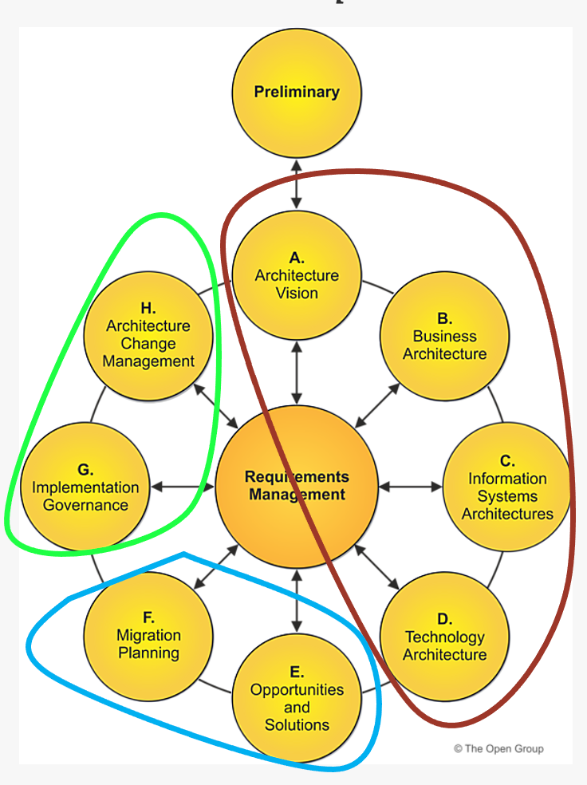

# TOGAF Preparation Guide
## Introduction
### Definitions
* **TOGAF**: The **O**pen **G**roup **A**rchitecture **F**ramework: An open framework for developping and architecture using a 9 activities life cycle 
: Method, A Content Framework and Continuum.
TOGAF is based on 1995 based on US DoD TAFIM 

* **Enterprise**: Any collection of organizations that shares common goals. It can include partners, supliers, customers (Extended Enterprise)
* **Architecture**: The structure of components, their inter-relationships, and the principles and guidelines governing their design and evolution over time

### Certifications
1. TOGAF Enterprise Architecture Foundation Foundation : Knowledge and comprehention of the TOGAF framework
2. TOGAF Enterprise Architecture Foundation Pratitioner : Application & Analysis in Scenarios in realistic scenarios

### Exam
**Format**: 40 Questions in 60min (90s/Q). >=60% (24/60) to pass

**TIPS**
* Options containing 'Always", 'never' 'must always', 'the only way' are usually Wrong statements in tailorable/flexible Framework like TOGAF
* Answers containing 'May", 'Typically', 'is recommanded', 'supports' are preferred

## ADM: Architecture Development Method

# Preliminary
Purpose: Defining the scope, tailor TOGAF Framework, architecture principle, level of acapabilities,
Output: Architecture principles, governance framework, readiness assessment
# A. Architecture Vision
Purpose: Set the scope, define current and future architecture vision and identifiyes stakeholders and ensure their commitment
Output: Statement of Architecture Work (the contract) and Architecture Definition Document

# B. Business Architecture
Output: Develop the Business architecture as per the agreed vision.
Perform the gap between baseline and target architecture
Output: Business Architecture
Anwsers "What" : Business capabiliies are captured in a Business Capabilities Catalog and a Business Capability Map

# C. Information System Architectures
Purpose: Develop Data and Application architecture 

# D. Technology Architecture

**Steps**
- [ ] 9 Steps for phases B, C and D 

1. Select reference models, viewpoints and tools
2. Develop Baseline Architecture description
3. Develop Target Architecture description
4. Perform Gap Analysis
5. Define candidate RoadMap components
6. Resolve impacts across the architecte Landscape
7. Conduct formal stakeholder review
8. Finalie the architecture
9. Create/update the Architecture Definition Documment

Method 
Group Phases B, C and D in "Architecture domains" BDAT
Group Phases E and F in "Planning"
Group Phases G and H in "Realization and change"

## Acronym
* ADM: Architecture Development Method
* ABB : Architecture Building Block (capability, the 'what')
* SBB:  Solution Building Block (implementation, the 'with what')
* ADD: : Architecture Definition Document
* ASR: Architecture Significant Requirement
* TRM: Technical Reference Model
* III-RM: Integrated Information Infrastructure Reference Model
* BDAT: Business, Data, Application, Technology

## Resources:
**YOUTUBE**

* https://www.youtube.com/playlist?list=PLrAWWpbaj-7KM0uNkxKAf2t4Kzyqr_pYy

* https://www.youtube.com/watch?v=MnKUY8O5FLM&list=PLB-CWVCN34-Fe_dKZYYKU-Lpjsi4m2Fov

**MindMap**

https://www.mindmeister.com/app/map/1336985988?fullscreen=1&v=public
 